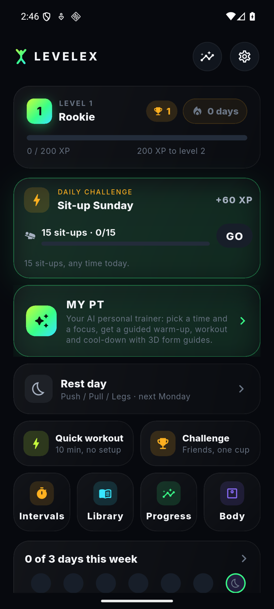
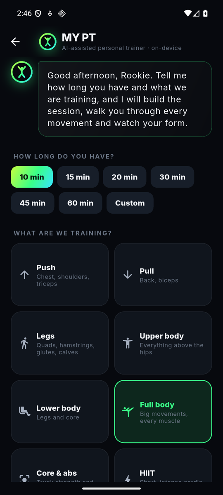
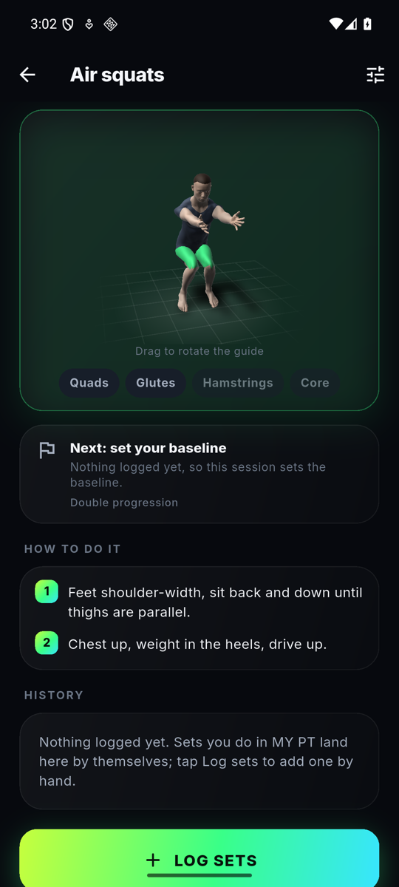
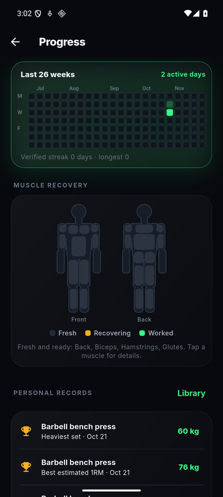

# Levelex

**Level up, one rep at a time.**


Levelex is an on-device workout coach for Android and iOS. Prop your phone
up, and the camera counts your reps, times your holds and corrects your form
while a voice coach talks you through the set. Every rep earns XP towards
the next level, reminders keep the habit going, and a guided personal
trainer builds full sessions around the equipment you own.

Everything runs on the phone: no backend, no account, no analytics, and
camera frames never leave the device.

<p align="center">
  
  
  
  
</p>

## Contents

- [Install the app](#install-the-app)
- [Features](#features)
- [Supported exercises](#supported-exercises)
- [Getting started](#getting-started)
- [Testing](#testing)
- [Project structure](#project-structure)
- [How it works](#how-it-works)
- [Tech stack](#tech-stack)
- [Permissions and privacy](#permissions-and-privacy)
- [Known limitations](#known-limitations)
- [Roadmap](#roadmap)
- [Contributing](#contributing)
- [License and credits](#license-and-credits)

## Install the app

Levelex is not in Google Play or the App Store. It is installed from the
project's [GitHub releases](https://github.com/khjabir/levelex/releases):

- **Android 7.0+:** download `levelex-android-arm64.apk` on the phone, allow
  installs from your browser when asked, and install.
- **iPhone (iOS 15.5+):** sideload `levelex-ios-unsigned.ipa` with
  Sideloadly or AltStore and your Apple ID, or build it with Xcode.

The project website (in [`website/`](website/), deployed on Vercel) walks
through both step by step. Maintainers: [docs/RELEASING.md](docs/RELEASING.md)
covers signing, publishing a release and deploying the site.

## Features

- **Camera rep counting** for 13 exercises with Google ML Kit pose
  detection, from the side, the front or a diagonal, in portrait or
  landscape, with the front or back camera.
- **Live form coaching**: spoken and on-screen corrections ("go lower",
  "hips up", "chest up"), a depth gauge, and coach's notes after each set.
  Strictness is adjustable.
- **MY PT**: a rule-based personal trainer that builds a warm-up, workout
  and cool-down for your time, focus and equipment, then walks you through
  it with the camera on, rest timers and a trainer voice.
- **3D guides**: a realistic, rigged human body demonstrates every one of
  60+ movements and lights up the muscles it trains. Drag to orbit.
- **Habit loop**: levels and XP, a daily challenge, streaks with rest days,
  a weekly goal and report, 30 achievements, and configurable reminders.
- **Strength log**: loads, progression rules (Linear, Greyskull, double and
  triple progression), personal records and 1RM estimates, weekly
  programmes, a muscle recovery map, weigh-ins and progress photos.
- **Challenge mode**: friends take turns in front of one phone; a podium
  and a hall of fame at the end.
- **Face check**: a one-time face registration so only you score your sets
  (skippable per set; skipped sets are saved as unverified).
- **Your data, your phone**: JSON backup and restore, and import from
  FitNotes, Strong, Hevy or an Apple Health export.

The full tour is in [docs/FEATURES.md](docs/FEATURES.md).

## Supported exercises

| Exercise | Counted by | Best phone placement |
|---|---|---|
| Push-ups | Shoulders dropping towards the hands | Side or front, 2–3 m, slightly above the floor |
| Squats | Hips dropping towards the ankles | Side or front, 2–3 m, head to feet in frame |
| Lunges | Hips dropping over the planted foot | Side, 2–3 m |
| Squat jumps | Hips dropping, then the jump | Side or front, 2–3 m, room for the jump |
| Burpees | Shoulders down to the floor with the hands planted | Side or front, about 3 m |
| Jumping jacks | Arms overhead and feet apart | Facing you or side-on, 2–3 m |
| High knees | Each knee drive | Facing you or side-on, 2–3 m |
| Mountain climbers | Each knee drive | Side or diagonal, low; not at your head |
| Sit-ups | Shoulders rising above the hips | Side or diagonal, low; not at your head or feet |
| Glute bridges | Hips rising above the shoulders | Side or diagonal, about 2 m, low |
| Tricep dips | Shoulders dropping towards the hands | Side, about 2 m |
| Plank (timed) | Time held with the body in line | Side, 2–3 m, low |
| Wall sit (timed) | Time held with the thighs level | Side, about 2 m |

MY PT also counts many gym movements (curls, presses, rows, raises, hinges,
pull-ups) through joint-angle specs.

## Getting started

### Prerequisites

- Flutter 3.47.x stable (Dart 3.13+)
- Android: Android SDK 36, JDK 17. Minimum Android 7.0 (API 24)
- iOS: macOS with Xcode 15.3+ and CocoaPods. Minimum iOS 15.5
- A physical phone: pose detection needs a real camera

### Install and run

```bash
git clone https://github.com/khjabir/levelex.git
cd levelex
flutter pub get
```

On iOS, install the pods and set your signing team in Xcode
(`ios/Runner.xcworkspace` → Runner → Signing & Capabilities):

```bash
cd ios && pod install && cd ..
```

Then run it on a connected phone:

```bash
flutter run --release
```

### Build

```bash
flutter build apk --release --split-per-abi
```

```bash
flutter build appbundle --release
```

```bash
flutter build ipa --release --export-method development
```

Release signing, the Android R8 rules, unsigned IPAs and other platform
details are in [docs/BUILDING.md](docs/BUILDING.md). To build every file a
GitHub release needs, with the names the website links to, run
`tool/release/build_release.sh` (see [docs/RELEASING.md](docs/RELEASING.md)).

## Testing

```bash
flutter test
```

```bash
flutter analyze
```

The suite (701 tests) covers the rep engine and every exercise analyzer
with synthetic bodies from several camera views, false positives such as a
hand in front of the lens, coaching, XP and levels, streaks, reminders,
face matching, progression, imports, and widget tests for the share cards,
calendar and strength screens.

`test/mlkit_replay_test.dart` replays 35 recordings of the real detector:
Google ML Kit run on rendered videos of the 3D athlete doing each exercise
from several phone placements. To regenerate them, or to measure a change
to the counters across all six placements, follow
[`tool/pose_probe/README.md`](tool/pose_probe/README.md).

## Project structure

```
lib/
  app/          app shell, theme, routes
  core/         thresholds, levels, engagement rules, maths utilities
  models/       exercise catalogue, pose and session models
  services/     camera + ML Kit, face verification, notifications, storage, voice
  features/
    workout/    camera sets and the rep-counting engine (analysis/)
    pt/         MY PT planner, session and 3D guide
    strength/   lift log, progression, programmes, progress, backup
    challenge/  multi-person challenge mode
    ...         home, history, engagement, settings, onboarding, face
  widgets/      shared UI components
test/           unit and widget tests, ML Kit replay fixtures, previews
tool/           3D body build, ML Kit probe app, release script, logo, website GLB
docs/           architecture, features, building, releasing, screenshots
website/        the project website (static HTML/CSS/JS)
vercel.json     serves website/ when the repository is imported into Vercel
```

## How it works

1. The camera streams frames to ML Kit pose detection at about 12 frames
   per second.
2. A tracker locks on to one plausible body and ignores hands, faces and
   people walking past.
3. Each exercise reduces the pose to one number relative to the user's own
   top position (for push-ups, the shoulders' height above the hands), so it
   reads the same from any angle and distance.
4. A hysteresis counter turns that signal into reps, with per-exercise rules
   for what must move and what must stay planted, so arm waving or walking
   never counts.
5. Form checks, the voice coach and the summary run off the same analysis.

The details, including the 3D guide pipeline and how the counters were
measured against the real detector, are in
[docs/ARCHITECTURE.md](docs/ARCHITECTURE.md).

## Tech stack

| Concern | Package |
|---|---|
| State and navigation | `flutter_riverpod` 3, `go_router` |
| Camera and pose | `camera`, `google_mlkit_pose_detection` |
| Face verification | `google_mlkit_face_detection`, `tflite_flutter` with a bundled MobileFaceNet |
| Equipment scan | `google_mlkit_image_labeling` |
| Storage | `hive_ce` (history), `shared_preferences` (settings) |
| Notifications | `flutter_local_notifications`, `timezone`, `flutter_timezone` |
| Voice and sound | `flutter_tts`, `audioplayers` |
| Motion | `sensors_plus` (gravity direction) |
| Charts | `fl_chart` |
| Sharing and files | `share_plus`, `file_picker`, `image_picker`, `path_provider` |

## Permissions and privacy

| Permission | When it is asked | Why |
|---|---|---|
| Camera | When you open the camera | Count reps and check your face, on the device |
| Notifications | After onboarding, or when turning reminders on | Show reminders |
| Exact alarms (Android 12+) | Optional, from Settings | Precise reminder times |

- Camera frames are analysed in memory and discarded. Nothing is recorded
  or uploaded.
- The registered face is stored only as a numeric embedding on the device,
  never as a photo. Erasing it also erases the score, so identities cannot
  be swapped.
- History, settings, equipment and progress photos stay in the app's
  private storage. Backups and share cards leave the phone only when you
  share them.
- There are no accounts, no analytics and no network calls by the app.

## Known limitations

- Form feedback is a geometric heuristic, not medical or coaching advice.
- Counting needs the whole body in frame and reasonable light. Floor
  exercises filmed end-on (from your head or feet) are the least reliable;
  film them from the side or a diagonal.
- Face verification is a convenience lock, not biometric security: a good
  photo of the registered user may pass.
- Reminders depend on the OS. Some Android battery optimisers delay them
  (see [dontkillmyapp.com](https://dontkillmyapp.com)), iOS allows 64
  pending notifications, and overnight reminder windows are not supported.
- The voice coach needs a text-to-speech engine; without one the app stays
  silent.
- English only, dark theme only.

## Roadmap

Next up, in priority order: creating the Android release key and publishing
the first release, deploying the website, field-testing the new counting on
real people, verifying the iOS build, and a placement assistant that tells
you when the phone is at a poor angle. The full list, with open product
decisions, is in [ROADMAP.md](ROADMAP.md). Everything fixed in the November
2026 audit is in [AUDIT.md](AUDIT.md).

## Contributing

1. Create a branch from `main`.
2. Keep the logic in plain Dart where possible, and add tests next to the
   existing ones in `test/`.
3. Before opening a pull request, run:

   ```bash
   dart format . && flutter analyze && flutter test
   ```

4. For a change to rep counting, also run the ML Kit replay across all
   placements ([`tool/pose_probe/README.md`](tool/pose_probe/README.md))
   and include the before and after counts.

Adding a camera exercise means an `ExerciseType` entry
(`lib/models/exercise.dart`), an analyzer in
`lib/features/workout/analysis/` registered in `analyzer_factory.dart`, a
3D clip in `lib/features/pt/mannequin/mannequin_clips.dart`, and replay
recordings from the six placements.

## License and credits

No license has been chosen for the Levelex code yet (see
[ROADMAP.md](ROADMAP.md#decisions-needed)), so all rights are reserved
until one is added.

Third-party assets:

- Body mesh: [Human Base Meshes](https://www.blender.org/download/demo-files/#asset-bundles)
  by Blender Studio, CC0.
- Face model: MobileFaceNet weights, Apache License 2.0
  (`assets/models/LICENSE-MobileFaceNet_TF.txt`, `assets/models/NOTICE.txt`).
- Font: Inter, SIL Open Font License (`assets/fonts/OFL.txt`).
- Notification icon derived from Material Symbols, Apache License 2.0.
- Strength-tracking features inspired by
  [openGym](https://github.com/DuarteSantos8/openGym), reimplemented from
  scratch.
